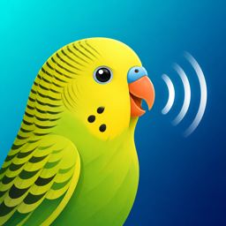

<p align="center">
  
</p>

# Parakeet Dictation

Native macOS / Apple Silicon dictation menu-bar app. Press a global
hotkey, speak, transcript inserts at your cursor. Recognition is fully
local — no API keys, telemetry, or network traffic after the model download
completes. An optional rewrite step hands the transcript to an OpenCode
service you already run.

The Cargo package and Rust library crate are `parakeet-dictation` and
`parakeet_dictation`. The user-facing app remains **Parakeet**, and its existing
`parakeet-rs` executable target is retained for bundle and permission stability.

- **ASR**: Parakeet Unified EN 0.6B int8 via a resident native Core ML worker
  with native contextual vocabulary
- **Rewrite (optional)**: the OpenCode service already running on the Mac
- **Shell**: AppKit Rust app + resident Swift helper (no Tauri / Electron)
- **Text injection**: `CGEventKeyboardSetUnicodeString` keystroke

## Install from source

No prebuilt releases — build it yourself. Apple Silicon Mac, macOS 14+.

1. **Install prerequisites** (skip what you already have):
   ```bash
   xcode-select --install                                            # codesign, cc, install_name_tool
   curl --proto '=https' --tlsv1.2 -sSf https://sh.rustup.rs | sh    # Rust 1.77+
   ```
2. **Clone, build, install**:
   ```bash
   git clone https://github.com/moorbrook/parakeet-rs && cd parakeet-rs
   scripts/make-app.sh                                               # ~60 s cold
   cp -R target/release/bundle/osx/Parakeet.app /Applications/
   open /Applications/Parakeet.app
   ```
3. **Gatekeeper bypass**: macOS may refuse the first launch with "Apple
   cannot verify this app is free of malware" because the bundle is signed
   with a local certificate instead of a Developer ID. Right-click the app
   in Finder → Open → Open Anyway. One-time confirmation.

For stable TCC permissions across rebuilds (so macOS doesn't treat each
build as a new app and lose your Microphone / Accessibility / Input
Monitoring grants), create a one-time self-signed "Code Signing"
certificate named `Parakeet Local Dev` in Keychain Access (Certificate
Assistant → Create Certificate…; Identity Type: Self Signed Root,
Certificate Type: Code Signing). `scripts/make-app.sh` then signs with it
automatically whenever it exists; without it the script falls back to an
ad-hoc signature and warns that permission grants will not survive
rebuilds. Details in
[ADR-0035](docs/ADR.md#0035--self-signed-local-identity-so-tcc-grants-survive-rebuilds).

## First launch

1. Parakeet explains **Input Monitoring**, the permission needed for its
   global hotkey. It stays running in the menu bar if you defer it, and does
   not trigger a macOS permission prompt until you choose **Grant**. If
   macOS suppresses that prompt (TCC already decided, or a rebuild changed
   the app's signature), **Grant** opens System Settings → Privacy &
   Security → Input Monitoring and logs what happened instead of failing
   silently.
2. The int8 Core ML model (~595 MB) and Silero Core ML VAD (~1 MB)
   download on first launch. They live under
   `~/Library/Application Support/com.parakeet.rs/models/`. All model downloads,
   including every file in the Core ML bundle, are pinned to immutable
   revisions and SHA-256 verified before use. Existing verified files are
   reused, and unchanged files use a local metadata cache on later launches.
   Menu bar status text shows setup progress.
3. Press `⌘⇧Space` (default hotkey), or choose **Start Dictation** from the
   menu. On the first attempt Parakeet explains and requests **Microphone** and
   **Accessibility**; neither is requested merely because the app launched.
   **Tap mode** waits through natural
   clause and sentence pauses before auto-stopping. **Tap Fast** uses a 90 ms stop
   window for short commands where latency matters more than pause
   tolerance. **Hold mode** stops on release.

While listening, a large-display HUD shows an animated pastel-iridescent
waveform on a 70%-alpha glass panel. macOS 26 and later use
`NSGlassEffectView`; older supported releases fall back to
`NSVisualEffectView`.

For HUD-only development, launch a debug build with the preview hook:

```bash
PARAKEET_HUD_PREVIEW=1 cargo run
```

The app opens directly into the Listening HUD without starting a dictation
session.

### Optional rewrite

Set Rewrite to On in Settings to have the OpenCode service that is already
running on this Mac (`opencode serve`) strip fillers, fix punctuation, and
honour inline commands ("new paragraph", "scratch that") before the text is
pasted. Parakeet never starts OpenCode and never reads or stores a provider
key: it reads OpenCode's owner-only loopback registration
(`~/.local/state/opencode/service.json`), checks that the registered process
answers, and posts one stateless generation. Enter the model as
`provider/model` with an optional variant; a reasoning model needs its `low`
variant to answer within the 5 s deadline. When OpenCode is not running, is
slower than 5 s, or answers with an error, the local transcript is pasted
unchanged. The transcript then leaves the Mac through whatever provider
OpenCode is configured for; see [`PRIVACY.md`](PRIVACY.md#the-opencode-rewrite).

### Custom vocabulary

Settings → **Edit Vocabulary…** opens a plain text file in your editor.
One term or phrase per line, spelled the way you want it transcribed:

```
Kubernetes
Ghostty
New York
```

Those words get boosted during recognition, which is the fix for names,
jargon, and product names Parakeet mishears. Click Save in Settings
afterwards — the recogniser rebuilds in the background (or as soon as
the current dictation finishes).

The native worker tokenizes terms with the model's piece inventory and boosts
matching paths in its greedy decoder. It reports rejected terms in the log.
An empty list adds no biasing. The boost is `hotword_score` in settings,
default 2.0. Recheck the gold corpus before changing it. See
[domain adaptation](docs/asr/DOMAIN_ADAPTATION.md).

### Apple Silicon runtime tuning

The shipped model is generic; an explicit tuner can benchmark its bounded Core
ML execution plans against this Mac and the checked-in human-speech quality
gate. It saves an inspectable hardware/OS/model-keyed profile that the app uses
only while all identities and recomputed evidence still match:

```bash
scripts/build-coreml-worker.sh
cargo run --release --locked --bin tune_asr -- \
  --repetitions 10 --load-repetitions 3
cargo run --release --locked --bin tune_asr -- --show-profile
```

Missing or stale profiles use the safe CPU+ANE baseline. Set
`PARAKEET_ASR_TUNING=off` to bypass a valid profile without deleting it. See
[`docs/asr/AUTOTUNING.md`](docs/asr/AUTOTUNING.md) for the selection gates,
profile removal, and current M5 Pro evidence.

### Settings and developer overrides

Settings lets you record a new global shortcut, select Tap, Tap Fast, or Hold,
turn the OpenCode rewrite on or off, and open the vocabulary file. Changes apply without restarting.
Caps Lock is also supported as a shortcut; because it emits toggle events
rather than a press/release pair, Parakeet gives it tap-to-start,
tap-to-finish semantics and locks the trigger selector accordingly.

Runtime and diagnostic overrides are intentionally narrow:

| Variable | Effect |
|---|---|
| `PARAKEET_ASR_TUNING=off` | Ignore a valid per-chip tuning profile without deleting it. |
| `PARAKEET_COREML_WORKER=/path/to/worker` | Use a specific native worker in development or benchmarks. |
| `PARAKEET_COREML_MODEL_DIR=/path/to/model` | Use an existing Core ML model directory. |
| `PARAKEET_HUD_PREVIEW=1` | Open the Listening HUD without recording. |
| `PARAKEET_PERMISSIONS_PREVIEW=startup\|dictation\|all` | Open a permission-dashboard scope using real permission state. |

Persistent settings, vocabulary, tuning evidence, and model paths are under
`~/Library/Application Support/com.parakeet.rs/`. See
[`PRIVACY.md`](PRIVACY.md#files-on-disk) for the exact disk inventory.

## Caveats

- **Apple Silicon only.** No plans for a universal binary
  ([ADR-0002](docs/ADR.md#0002--macos-only)).
- **ASR requires macOS 14+.** Worker or model load failures produce a clear
  setup error. Recognition uses the native Core ML worker for all vocabulary
  settings.
- **Text injection** works in terminals (Ghostty, iTerm2, Terminal.app),
  browsers, native Cocoa, Electron (Slack/VS Code/etc.), JetBrains,
  Xcode. Doesn't reach password fields or apps with aggressive input
  filtering. When injection fails *observably*, the transcript goes to
  the clipboard and the menu bar says so. `CGEventPost` gives no
  delivery receipt, so an app that accepts the keystroke and discards it
  still looks like success — see [`PRIVACY.md`](PRIVACY.md#clipboard).
- **Bundle contents**: Rust executable, native worker, and notices. Model
  weights download separately. No inference-runtime dylibs are bundled.

## Layout

App state lives behind a small state machine so session races stay
localised:

`hotkey/menu → capture → VAD + speculative ASR → optional OpenCode rewrite →
synthetic Unicode keystroke`. Silero remains the sole
endpoint authority; speculative recognition is discarded if speech resumes.

- `src/app.rs` — orchestration, supervised worker spawns, panic recovery
- `src/dictation_fsm.rs` — atomic (state, session, pending_terminate)
- `src/rewrite.rs` — OpenCode discovery and the bounded rewrite request
- `src/paste.rs` — `TextSink` trait + one-shot delivery
- `src/ax_paste.rs` — `CGEvent` keystroke implementation
- `src/streamer.rs` — per-session VAD/manual capture
- `src/vocabulary.rs` — `vocabulary.txt` parsing for native contextual biasing
- `src/coreml_worker.rs` — framed IPC, native model loading, and inference metrics
- `native/ParakeetCoreMLWorker/` — pinned FluidAudio/Core ML deployment worker
- `src/clipboard.rs` — rescue copy when keystroke delivery fails
- `src/{audio,asr,vad,hud,hotkey,menubar,settings,settings_ui,…}.rs`

Four headless tools live under `src/bin/`: `bench_asr` measures the
recognition stage; `bench_e2e` replays production capture,
endpointing, and recognition; `asr_diff` gates transcript quality; and
`tune_asr` selects an evidence-backed runtime plan.

Privacy behaviour — what each permission does, what touches the network,
what lands on disk — is documented in [`PRIVACY.md`](PRIVACY.md). Permission
state, recovery behavior, and the clean/revoked QA matrix are in
[`docs/macos-permissions.md`](docs/macos-permissions.md).

Architectural rationale lives in [`docs/ADR.md`](docs/ADR.md) (decisions
0001-0040). Reproducible latency and quality evidence lives in
[`bench/README.md`](bench/README.md); the original, now-archived optimization
plan is [`docs/latency-plan.md`](docs/latency-plan.md). The deferred
Developer-ID/notarization shipping procedure is captured in
[`docs/notarized-distribution.md`](docs/notarized-distribution.md).

## Verification

```bash
scripts/make-app.sh
cargo run --release --locked --bin bench_asr -- --help
cargo test --locked
cargo clippy --locked --all-targets --no-deps
```

With the `BlackHole 2ch` loopback available, verify endpointing against recorded
human speech. The Hold failure check uses the three-second fixture generated
by `scripts/bench-latency.sh` and asserts every spoken word survives a VAD crash:

```bash
scripts/bench-endpoint-policy.sh
scripts/check-vad-failure.sh
```

Anything that could change what the recogniser *says* — model weights,
execution provider, vocabulary, hotword score — should also be checked
against recorded transcripts, not just latency:

```bash
scripts/bench-latency.sh                 # generates bench/audio/ fixtures
BACKEND=coreml-unified OUT_CSV=bench/coreml.csv \
  scripts/bench-latency.sh               # matched native-backend run
./target/release/asr_diff --record       # baseline (machine-local)
# ...make the change...
./target/release/asr_diff                # exits 1 on any transcript drift
```

Before comparing a new model or backend, use human-authored references rather
than treating the current model's output as truth:

```bash
REPETITIONS=10 scripts/bench-gold.sh
# Human summaries on stdout; machine reports under bench/ (gitignored).
```

The gold manifest owns the WER/CER limits. Lexical scoring lowercases and
removes punctuation while the report tracks exact formatting separately, so a
punctuation-only regression remains visible without inflating WER.

## License

Dual-licensed under [MIT](LICENSE-MIT) or [Apache-2.0](LICENSE-APACHE)
at your option (Rust ecosystem convention).

Runtime-downloaded models ship under their own licenses: Parakeet Unified EN 0.6B Core ML and its 2/5/8 s
encoder buckets (NVIDIA Open Model License), Silero VAD (MIT). See
[`THIRD_PARTY_NOTICES.md`](THIRD_PARTY_NOTICES.md).
